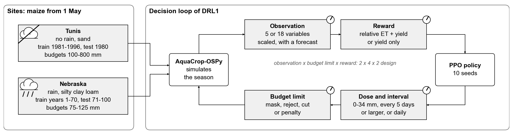
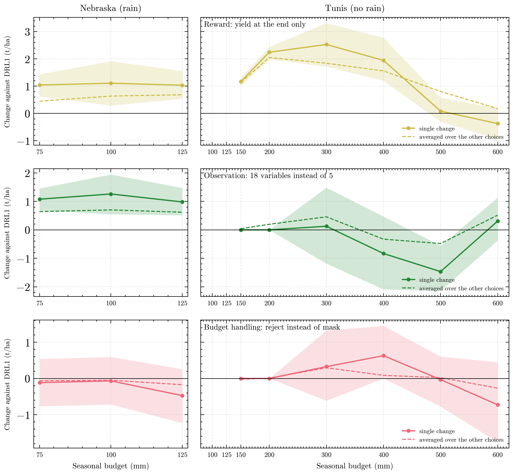

# DIT-RL revision experiments

Experiments for the revision of *Benchmarking deep reinforcement learning strategies for the optimal scheduling of deficit irrigation systems* (Agricultural Water Management, AGWAT-D-26-00823): maize irrigation in AquaCrop-OSPy under a hard seasonal water budget.

## Core deliverables: finished

The core part of the ablation is complete: DRL1 and three variants that each change one design choice (18 observed variables, rejecting a dose above the remaining budget, rewarding only the yield at the end), in Tunis at 300 and 500 mm and in Nebraska at 75 mm, with 10 seeds each.

| Deliverable | File |
|---|---|
| Configuration of the four variants (design choices, PPO settings, training, evaluation) | [reports/tables/core_ablation_configuration.md](reports/tables/core_ablation_configuration.md) |
| Results per case and variant: mean and spread over seeds, paired difference to DRL1, 10 % quantile | [reports/tables/core_ablation_results.md](reports/tables/core_ablation_results.md) |
| Paired difference to DRL1 per seed | [reports/figures/core_ablation.png](reports/figures/core_ablation.png) |
| Raw tables of these runs | [results/ablation_one_change/](results/ablation_one_change/), [results/ablation_more_seeds/](results/ablation_more_seeds/) |

Further experiments and analyses are added as their results come in, until the status table below is filled.

## How it works

The command line tool `ditrl` runs the whole plan in four steps:

1. `config/plan.yaml` lists the sites, the methods and every experiment, with every number used.
2. `ditrl run <experiment> --shard I/N` trains and tests each job of an experiment and writes one folder per job to `runs/`. Any number of machines can each run one shard, and finished jobs are skipped.
3. `ditrl export <experiment>` collects the job folders into tables in `results/<experiment>/`.
4. `ditrl report` rebuilds the figures and tables in `reports/` and the two sections below.

Setup and details: [docs/usage.md](docs/usage.md).

<!-- report:start -->
## Status

Filled in by `ditrl report` after every batch of results (last on 2026-10-11 18:24).

| Stage | Experiment | What it tests | Runs | Results |
|---|---|---|---|---|
| 1 | `benchmark` | DRL1, DRL2 and the rules over the budgets, 5 seeds | 0 of 98 | pending |
| 1 | `ablation_one_change` | core part: DRL1 and three variants that each change one design choice | 60 of 60 | [results/ablation_one_change/](results/ablation_one_change/) |
| 2 | `ablation_budget_handling` | the other two budget limits, and all three settings of Kelly et al. at once | 45 of 45 | [results/ablation_budget_handling/](results/ablation_budget_handling/) |
| 2 | `ablation_interactions` | the remaining cells of the 2 x 4 x 2 design | 135 of 135 | [results/ablation_interactions/](results/ablation_interactions/) |
| 2 | `benchmark_seeds` | DRL1 and DRL2 with 5 more seeds | 0 of 80 | pending |
| 2 | `benchmark_budgets` | the rest of the yield over budget curve in Tunis | 0 of 154 | pending |
| 2 | `low_budget` | larger doses and daily decisions at small budgets | 0 of 120 | pending |
| 2 | `robustness` | the benchmark policies with noisy observations | 0 of 4800 | pending |
| 2 | `ablation_more_seeds` | the 16 cells of the design with 5 more seeds | 240 of 240 | [results/ablation_more_seeds/](results/ablation_more_seeds/) |
| 2 | `ablation_more_budgets` | the 16 cells of the design at the other budgets | 900 of 960 | [results/ablation_more_budgets/](results/ablation_more_budgets/) |
| 3 | `forecast` | DRL1 with a perfect 7-day weather forecast | 0 of 80 | pending |
| 3 | `test_year` | DRL1 trained on the test year itself | 0 of 320 | pending |
| 3 | `obs_scaled` | the 18 variables, scaled | 0 of 80 | pending |
| 3 | `oracle_ds` | best schedule per test year with known weather (not run, published values used) | 0 of 927 | pending |
| 3 | `oracle_ss` | one robust schedule for all years (not run, published values used) | 0 of 45 | pending |

## First look

Test yield of the variant minus DRL1 with the same seed, mean over seeds with 95 % bootstrap band (solid), and the same change averaged over the other choices of the 2 x 4 x 2 design (dashed). Gaps: no results for that budget.

<!-- report:end -->

## Where things are

| Path | Content |
|---|---|
| `config/plan.yaml` | the experiment plan |
| `results/<experiment>/` | result tables per experiment |
| `reports/` | figures and tables, listed in [reports/README.md](reports/README.md) |
| `docs/` | [why each experiment exists](docs/experiment-plan.md), [decisions](docs/decisions.md), [usage](docs/usage.md) |
| `data/` | input weather and external reference values, see [data/README.md](data/README.md) |
| `src/ditrl/` | the code |
| `runs/` | raw job folders with models and logs (not in git) |
