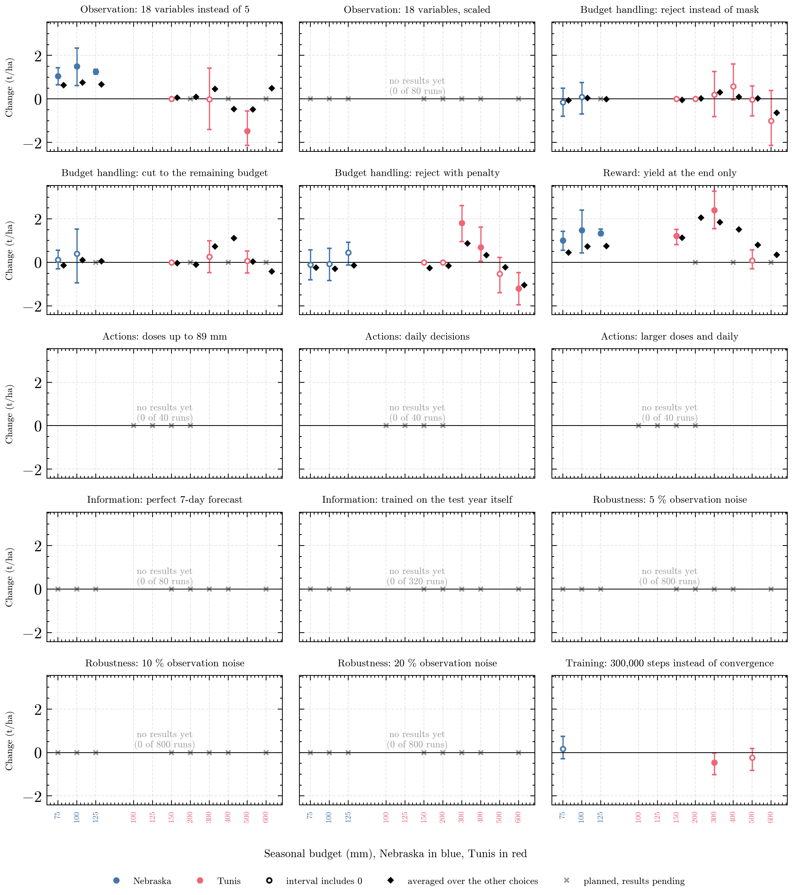

# DIT-RL revision experiments

Experiments for the major revision of *Benchmarking deep reinforcement learning strategies for the optimal scheduling of deficit irrigation systems* (Schütze, Kunze, Grové; Agricultural Water Management, AGWAT-D-26-00823): maize irrigation in AquaCrop-OSPy under a hard seasonal water budget, scheduled by two DRL configurations (DRL1 and the reference DRL2 of Kelly et al. 2024), simple rules, and an optimizer with perfect weather foresight.


<!-- report:start -->
## Current results

Updated automatically on 2026-10-11 12:40 by `ditrl report`. 1080 of 2372 trainings and rule runs have results. 100% of 1080 ablation runs converged before the step limit; median training length 500k steps. [Progress per experiment](reports/tables/progress.md)

### Central findings

**1. Rewarding only the yield at the end works better than the stepwise reward of DRL1.** Changing only the reward raises test yield by +1.01 t/ha [+0.55, +1.42] in Nebraska at 75 mm and by +2.39 t/ha [+1.54, +3.27] in Tunis at 300 mm. The stepwise reward pays relative evapotranspiration every day, which is cheapest to earn early in the season while the canopy is small, so DRL1 spends its water before the stages that decide the yield. In Tunis at 150 and 200 mm the crop has so far died in every run with the stepwise reward, whatever the other choices. Only with a large budget (Tunis 500 mm, +0.08 t/ha [-0.30, +0.57]) is the timing nearly the same and so is the yield.


**2. The 18 variables of Kelly et al. help in Nebraska and hurt in Tunis.** In Nebraska the 18 variables raise test yield by +1.05 t/ha [+0.65, +1.43] at 75 mm, in Tunis they lower it by -1.47 t/ha [-2.14, -0.56] at 500 mm. Nebraska has rain and weather that differs from year to year, which the extra variables can describe. Tunis is simulated without rain, so there they plausibly add mostly noise. The 18 variables enter unscaled, and the run with scaled variables, still pending, shows whether part of the effect is a scaling effect.

**3. How the budget is enforced matters less than the reward, and its effect depends on the case.** Rejecting a dose that exceeds the remaining budget instead of masking it changes test yield by -0.15 t/ha [-0.80, +0.50] in Nebraska at 75 mm and by +0.19 t/ha [-0.82, +1.26] in Tunis at 300 mm. Adding a penalty to the rejection helps in Tunis at 300 mm (+1.81 t/ha [+0.95, +2.62]) but costs yield at 600 mm (-1.20 t/ha [-1.95, -0.46, 8 of 10 runs]). Masking, the choice of DRL1, is therefore not better than the alternatives. Where a single change and the same change averaged over the other choices (diamonds in the figure below) differ, the choices interact, most clearly for the reward in Tunis at 500 mm.

**4. Training until convergence instead of 300,000 steps changed the yield little, except in Tunis at 300 mm.** Converged runs and the same runs after 300,000 steps differ by +0.17 t/ha [-0.28, +0.75] in Nebraska at 75 mm and by -0.46 t/ha [-1.02, -0.03] in Tunis at 300 mm (300,000 steps minus converged), so the earlier results were not an artefact of training too short.

### What changes what

Each panel changes one thing about DRL1. Dot: mean change of test yield against DRL1 trained with the same seed, with 95 % bootstrap interval over seeds; filled when the interval excludes 0. Diamond: the same change averaged over the other choices of the 2 x 4 x 2 design. Cross: planned, results pending.



[Numbers](reports/tables/sensitivity.md) · [Agreed ablation for the co-author](reports/README.md#agreed-ablation) · [All figures and tables](reports/README.md)

<!-- report:end -->

## Quick start

```bash
make install                      # Python 3.10 environment, every dependency pinned
ditrl list stage1                 # jobs of a stage or experiment, and how many are done
ditrl run stage1 --shard 1/2      # run them (resumable); one shard per machine
ditrl export stage1               # result tables -> results/<experiment>/
ditrl report                      # figures and tables -> reports/, and the block above
```

Every DRL run trains until it converges and is tested with its final policy. More on running on several machines, the result layout and the paper assets: [docs/usage.md](docs/usage.md).

## Where things are

| Path | Content |
|---|---|
| `config/plan.yaml` | the whole experiment plan; every number lives here |
| `config/findings.md` | the central findings, written by hand; the report fills in their numbers |
| `docs/` | [experiment plan](docs/experiment-plan.md) (why each experiment exists), [decisions](docs/decisions.md), [usage](docs/usage.md) |
| `results/` | result tables per experiment (in git) |
| `reports/` | figures and tables built from them, with an [index](reports/README.md) |
| `src/ditrl/` | the code: plan, environment, training, rules, oracle, runner, export |
| `src/ditrl/report/`, `src/ditrl/analysis/` | the report generators, and the paper's figures, tables and statistics |
| `runs/` | raw job folders with models and logs (not in git) |
