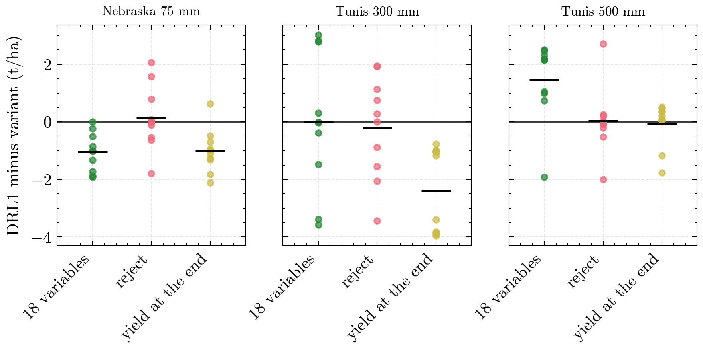

# Report

Built by `ditrl report` from the tables in `results/`; do not edit by hand. Every figure exists as PNG and PDF, every table as Markdown and CSV. The module named under each entry generates it (`src/ditrl/report/`). The central findings are in [findings.md](findings.md).

## System

### System overview

How an experiment plan becomes runs, result tables and this report.

Files: `figures/overview.png`, `.pdf`. Generated by `ditrl.report.overview`.

## Progress

### Progress

Planned and finished jobs per experiment.

[Table](tables/progress.md)

Files: `tables/progress.md`, `.csv`. Generated by `ditrl.report.progress`.

## What changes what

### What changes what

Each panel changes one thing about DRL1. Dot: mean change of test yield against DRL1 trained with the same seed, with 95 % bootstrap interval over seeds; filled when the interval excludes 0. Diamond: the same change averaged over the other choices of the 2 x 4 x 2 design. Cross: planned, results pending.

Files: `figures/sensitivity.png`, `.pdf`. Generated by `ditrl.report.sensitivity`.

### What changes what (table)

Change of test yield in t/ha against DRL1 with 95 % interval, per case; "(k of n)": only k of the n planned runs are in; "pending": too few seeds yet; empty: not planned. `sensitivity_long.csv` has every number.

[Table](tables/sensitivity.md)

Files: `tables/sensitivity.md`, `.csv`. Generated by `ditrl.report.sensitivity`.

## Agreed ablation

### Agreed ablation, configuration

Design choices, PPO settings actually used, training and evaluation of the four variants.

[Table](tables/agreed_ablation_configuration.md)

Files: `tables/agreed_ablation_configuration.md`, `.csv`. Generated by `ditrl.report.agreed`.

### Agreed ablation, results

Test yield per case and variant over all seeds, and the paired difference to DRL1 per seed.

[Table](tables/agreed_ablation_results.md)

Files: `tables/agreed_ablation_results.md`, `.csv`. Generated by `ditrl.report.agreed`.

### Agreed ablation, paired differences (10 seeds)

Mean test yield of DRL1 minus that of each variant, one dot per seed (10 seeds), bar at the mean. Above zero: the change costs yield; below zero: the variant is better than DRL1.

Files: `figures/agreed_ablation.png`, `.pdf`. Generated by `ditrl.report.agreed`.

### When the water is applied, by reward

Mean cumulative irrigation over the season in the test years (all seeds), in 10-day steps; dotted line: budget. The legend gives the share of test seasons in which the crop dies.

Files: `figures/agreed_irrigation_timing.png`, `.pdf`. Generated by `ditrl.report.agreed`.

## Appendix: training diagnostics

### Agreed ablation, learning curves

Mean yield on the validation years during training, median and interquartile range over seeds, averaged in bins of 50,000 steps, drawn while at least half of the runs are still training. In Nebraska the validation years are the test years; nothing is selected on them.

Files: `figures/agreed_learning_curves.png`, `.pdf`. Generated by `ditrl.report.training`.

### Agreed ablation, training dynamics

PPO statistics during training (median and interquartile range over seeds): episode return (reward scales differ between rewards), entropy of the policy, how much of the return the value function explains, and the size of each policy update.

Files: `figures/agreed_training_dynamics.png`, `.pdf`. Generated by `ditrl.report.training`.

### Training length until convergence

Steps each run of the agreed variants trained before the stopping rule ended it, one dot per run.

Files: `figures/training_length.png`, `.pdf`. Generated by `ditrl.report.training`.
