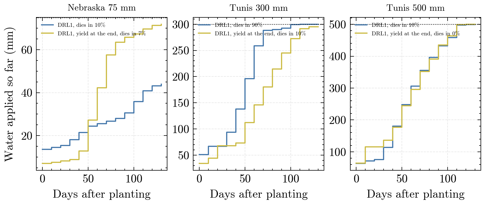
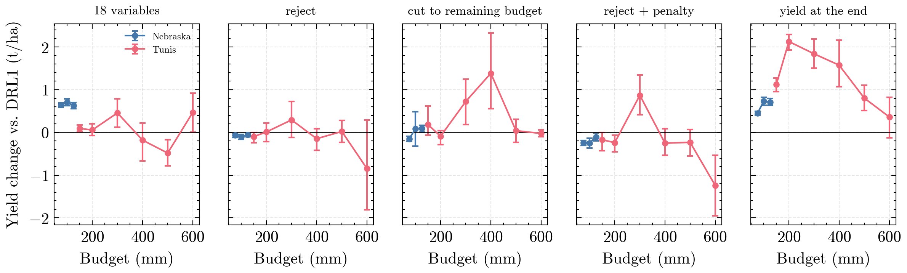
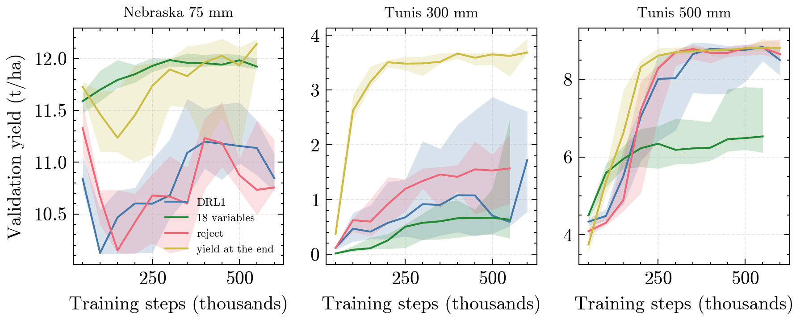
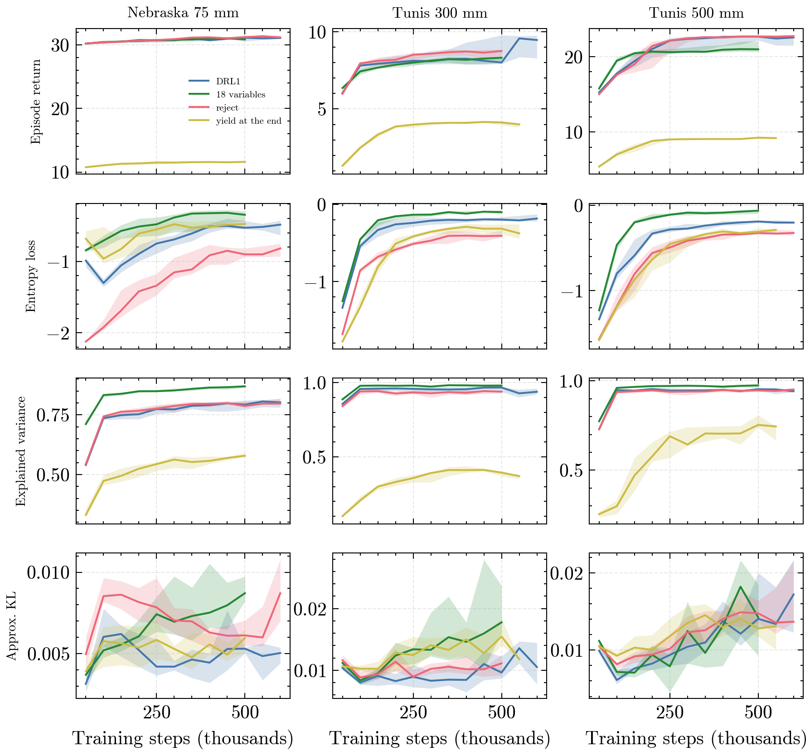
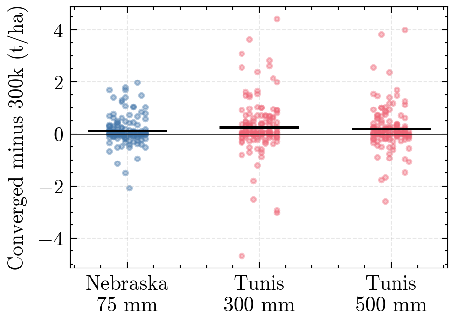

# Findings

Notable results, written down when a batch of results comes in; newest first. The figures are rebuilt by `ditrl report` and always show the current data; the numbers quoted here are those of the date in the heading.

## 2026-10-11: Why the yield at the end works better as reward

**With relative evapotranspiration at every step, DRL1 applies its water at the wrong time.** The step reward (Tr + Es) / (TrPot + EsPot) counts every day the same and also counts evaporation from wet soil, so it pays off most early in the season, when the canopy is small and a little water already brings the ratio close to 1. It also dominates the return: in Nebraska the episode return during training is about 30 with the step reward against about 11 with the yield alone. In Tunis at 300 mm DRL1 applies half of its budget by day 45 after planting (yield only: day 65), has used it up by day 90 and the crop dies in 9 of 10 runs (yield only: 1 of 10). In Nebraska at 75 mm DRL1 leaves 31 mm of the budget unused, while the variant rewarded with the yield uses 72 of 75 mm, most of it between day 50 and 80. At 500 mm in Tunis the budget is large enough that the timing hardly differs, and so does the yield. The step reward is not a potential-based shaping term, so it changes which policy is optimal instead of only speeding up learning, and with about 26 decisions per season the yield alone is still easy to learn. Tunis has only one test year, so its numbers are 10 seeds in a single season.

## 2026-10-10: Agreed ablation and full design, trained until convergence

**The reward is the strongest design choice.** Rewarding the yield at the end of the season only, instead of relative evapotranspiration at every step plus the yield, raises test yield in every case: +0.45 t/ha in Nebraska at 75 mm, +1.84 t/ha in Tunis at 300 mm and +0.81 t/ha at 500 mm (main effects over the full 2 x 4 x 2 design, 10 seeds, all significant after Holm correction). The extra budgets of the ablation, which are still coming in, show the same direction up to 400 mm.

**DRL1 is in no case the best of the four agreed variants.** With 10 seeds: Nebraska 75 mm DRL1 10.95 t/ha against 12.00 with 18 variables and 11.97 with the yield at the end; Tunis 300 mm 1.82 against 4.22 with the yield at the end; Tunis 500 mm 9.70 against 9.78. [Results table](tables/agreed_ablation_results_10_seeds.md)

**Masking pays off in Nebraska only.** Every other budget handling costs 0.06 to 0.25 t/ha there, while at Tunis 300 mm cutting to the remaining budget and rejecting with a penalty are 0.72 and 0.87 t/ha better than masking.

**DRL1 and reject do not settle in Nebraska.** Their validation yield rises to about 11.2 t/ha around 400,000 steps and falls again towards the end of training, with a wide spread over seeds; the variants with 18 variables or the yield at the end climb higher and stay there. Testing the last policy, as agreed, therefore costs DRL1 more than the other variants.

**With 18 variables the policy updates keep growing.** The approximate KL divergence between successive policies rises steadily over training with 18 variables but stays flat with the 5 variables of DRL1. The 18 variables enter unscaled (for example biomass and the day of the month next to fractions), which plausibly makes the updates harder to control; the experiment with scaled observations (`obs_scaled`, stage 3) tests this. With the yield at the end as the only reward, the value function explains much less of the return, as expected for a sparse reward, without costing yield.

**Training until convergence changed little.** Continuing the 300,000-step runs until the stopping rule ended them added a median 200,000 steps and raised test yield by 0.14 to 0.26 t/ha on average; about a quarter of the runs ended slightly lower, and the ranking of the variants stayed the same.

